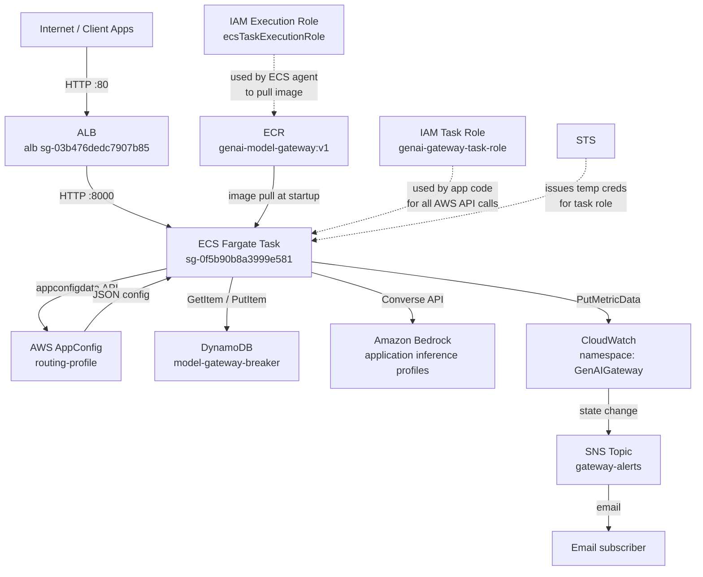

# AWS Components Deep-Dive — Project 1: GenAI Model Gateway

This document covers every AWS component used in Project 1 — a FastAPI service that
routes three tasks (summarize, draft, answer) to Amazon Bedrock models, deployed on ECS
Fargate behind an Application Load Balancer. The goal is a clear mental model of each
component and how they wire together.

---

## 1. How Everything Connects



### One request, end to end

A client app sends `POST /v1/generate` with `{"task": "summarize", "messages": [...]}`.

1. The request hits the **ALB** on port 80. The ALB's security group allows TCP 80 from
   the internet (`0.0.0.0/0`).

2. The ALB evaluates its listener rule — "all traffic goes to target group
   `genai-gateway-tg`" — and forwards the request to the ECS task's private IP on port
   8000. The ALB knows the task's IP because ECS registered it when the task started.

3. The request reaches the **FastAPI** process inside the **ECS Fargate task**. The task
   security group allows TCP 8000 inbound, but only from the ALB security group — not
   from the internet directly.

4. `main.py` calls `invoke(request)` in `bedrock.py`. Before calling Bedrock, the code
   calls `get_task_config("summarize")` which polls **AppConfig** to get the routing
   profile — the JSON that maps tasks to model ARNs.

5. The code checks **DynamoDB** (the circuit breaker table) to see if the primary model
   is currently open (tripped). If not, it calls **Bedrock** via the Converse API.

6. After the response arrives, `metrics.py` pushes token counts and latency to
   **CloudWatch** as custom metrics under the `GenAIGateway` namespace.

7. If a CloudWatch alarm threshold is crossed (e.g. a degraded response occurred), it
   publishes to the **SNS** topic `gateway-alerts`, which delivers an email to the
   subscriber.

For all of this to work — AppConfig, DynamoDB, Bedrock, CloudWatch — the app code needs
AWS credentials. It gets them through **IAM** and **STS**: the ECS task role
`genai-gateway-task-role` is attached to the task definition, ECS injects temporary
credentials via the metadata endpoint at `http://169.254.170.2`, and boto3 picks them up
automatically.

---

## 2. Networking

### VPC

A VPC (Virtual Private Cloud) is a private, logically isolated section of the AWS network
that belongs to your account. Think of it as your own private data centre network inside
AWS. No other AWS account can reach resources inside your VPC unless you explicitly allow
it.

Every VPC has a **CIDR block** — a range of private IP addresses the VPC owns. For
example, `172.31.0.0/16` means all addresses from `172.31.0.0` to `172.31.255.255`
(65,536 addresses). Resources you create inside the VPC get IP addresses from this range.

AWS automatically creates a **default VPC** in every region for every account. This is
what this project used (`vpc-065e3f67a122a7c53`, CIDR `172.31.0.0/16`). The default VPC
is configured with sensible defaults — subnets in every AZ, an internet gateway attached,
and routes in place. For learning and development, using the default VPC is fine. In
production, teams typically create a dedicated VPC with explicit CIDR planning and no
default open routes.

### Subnets

A subnet is a slice of the VPC's CIDR range, pinned to one Availability Zone (AZ). An AZ
is a physically separate data centre within a region. `ap-southeast-2` has three AZs:
`ap-southeast-2a`, `ap-southeast-2b`, `ap-southeast-2c`.

The two subnets this project used:

| Subnet ID | AZ | CIDR |
|---|---|---|
| `subnet-02bd837505c20e373` | `ap-southeast-2a` | `172.31.0.0/20` |
| `subnet-095c8e43efe4ee5c8` | `ap-southeast-2b` | `172.31.16.0/20` |

**Public vs private subnets:**

What makes a subnet "public" is not a flag on the subnet — it is whether the subnet's
route table has a route to an **Internet Gateway (IGW)**. An Internet Gateway is an AWS
resource that connects your VPC to the public internet.

```
Public subnet route table:
  Destination       Target
  172.31.0.0/16     local         ← traffic within the VPC stays inside
  0.0.0.0/0         igw-xxxxxxx   ← everything else goes to the internet

Private subnet route table:
  Destination       Target
  172.31.0.0/16     local         ← only internal traffic
  (no 0.0.0.0/0 route)
```

A resource in a public subnet with a public IP can receive traffic from and send traffic
to the internet. A resource in a private subnet cannot — it can only talk to other
resources in the VPC, or to AWS services via VPC endpoints or a NAT Gateway.

The default VPC's subnets are all public. The ALB and ECS tasks were both placed in these
public subnets. In production, ECS tasks would typically sit in private subnets (no direct
internet exposure), with only the ALB in public subnets. But for this learning project, it
does not matter — the task security group ensures the tasks are not reachable from the
internet regardless of subnet type (more on this below).

### Security Groups

A security group is a stateful virtual firewall that is attached to a **network
interface** (ENI), not to a subnet. Every resource that handles network traffic — an ALB,
an ECS task, an RDS instance — has at least one ENI, and each ENI has one or more
security groups attached.

**Stateful** is the key word. It means: if an inbound connection is allowed, the response
traffic is automatically allowed back out, without needing an explicit outbound rule.
Similarly, if an outbound connection is initiated and allowed, the response coming in is
automatically allowed. You only write rules for the direction you initiate — never for
the return traffic.

```
Without stateful tracking (stateless, like a network ACL):
  Request in:  needs an inbound rule   ← you write this
  Reply out:   needs an outbound rule  ← you must also write this

With stateful tracking (security groups):
  Request in:  needs an inbound rule   ← you write this
  Reply out:   automatically tracked   ← no rule needed
```

#### Inbound and Outbound rules

- **Inbound rules**: control traffic arriving at the resource. "Who is allowed to connect
  to me, on which port?"
- **Outbound rules**: control traffic leaving the resource. "Who am I allowed to connect
  to, on which port?"

#### Rule anatomy

Each rule has four fields:

**Type** — a convenience label in the AWS console that pre-fills the Protocol and Port
Range fields. Examples:

| Type label | Protocol | Port |
|---|---|---|
| HTTP | TCP | 80 |
| HTTPS | TCP | 443 |
| Custom TCP | TCP | (you specify) |
| All traffic | All | All |
| SSH | TCP | 22 |

The `Type` field is UI sugar. What actually matters is Protocol + Port.

**Protocol** — the transport protocol:

- **TCP** (Transmission Control Protocol): connection-oriented, reliable, ordered delivery.
  Used for HTTP, HTTPS, database connections, SSH — anything that needs delivery
  guarantees. Almost everything in this project uses TCP.
- **UDP** (User Datagram Protocol): connectionless, no delivery guarantee, low overhead.
  Used for DNS lookups, video streaming, game networking. Not used in this project.
- **ICMP** (Internet Control Message Protocol): not for data transfer — used for network
  diagnostics (`ping`, traceroute). Not used in this project.

**Port Range** — which port(s) the rule applies to. Can be a single port (`8000`) or a
range (`8000-9000`). Well-known ports used in this project:
- **80**: HTTP (ALB listener)
- **8000**: The FastAPI process inside the ECS task (non-standard, chosen by us)

**Source (inbound) / Destination (outbound)** — where the traffic comes from or goes to.
Two forms:

1. **CIDR block**: a range of IP addresses. `0.0.0.0/0` means any IPv4 address — i.e.,
   the entire internet. `172.31.0.0/16` means any address inside the VPC.

2. **Security Group ID**: instead of an IP range, you reference another security group
   by its ID. This means: "allow traffic from any network interface that has THIS security
   group attached." This is called security group chaining and is far more reliable than
   CIDRs for traffic between AWS resources within the same VPC — because IP addresses of
   AWS resources can change (e.g. when an ECS task is replaced), but the security group
   ID is stable.

#### Project 1's rules

**ALB Security Group (`sg-03b476dedc7907b85`)**

| Direction | Type | Protocol | Port | Source / Destination |
|---|---|---|---|---|
| Inbound | HTTP | TCP | 80 | 0.0.0.0/0 (internet) |
| Outbound | Custom TCP | TCP | 8000 | sg-0f5b90b8a3999e581 (Task SG) |

- The inbound rule allows anyone on the internet to send HTTP requests to the ALB on port
  80. This is correct — the ALB is the public entry point.
- The outbound rule says: when the ALB forwards a request, it can only go to resources
  that have the Task SG attached, on port 8000. The ALB has no business talking to
  anything else inside your VPC.

**Task Security Group (`sg-0f5b90b8a3999e581`)**

| Direction | Type | Protocol | Port | Source / Destination |
|---|---|---|---|---|
| Inbound | Custom TCP | TCP | 8000 | sg-03b476dedc7907b85 (ALB SG) |
| Outbound | All traffic | All | All | 0.0.0.0/0 |

- The inbound rule says: only accept connections on port 8000 from resources that have the
  ALB SG attached. Even though the ECS task sits in a public subnet with a public IP, it
  is not reachable from the internet — no rule allows port 8000 from `0.0.0.0/0`. Only
  the ALB can reach it.
- The outbound rule allows all traffic out. This is needed because the ECS task initiates
  connections to Bedrock, DynamoDB, AppConfig, and CloudWatch — all AWS API endpoints.
  These endpoints have public IP addresses (unless you set up VPC endpoints). "All
  outbound" sounds permissive but it is acceptable here because the stateful tracking
  means the return traffic from these calls is also handled, and the task does not listen
  on any unexpected ports — it only initiates calls outward.

#### Why security group chaining is better than CIDRs

If you used a CIDR for the Task SG's inbound rule, you'd need to know the ALB's IP
address. The ALB spans multiple AZs and its IP addresses change over time. Using the ALB's
security group ID as the source means the rule automatically applies to any IP the ALB
uses, now and in the future, without any manual updates.

```
CIDR-based rule (fragile):
  Inbound TCP 8000 from 172.31.3.45/32    ← breaks when ALB IP changes

SG-chained rule (stable):
  Inbound TCP 8000 from sg-03b476dedc7907b85  ← always correct
```

---

## 3. Identity and Access

### IAM Roles — from first principles

The fundamental question is: when your Python code inside a Fargate container calls
`boto3.client("bedrock-runtime").converse(...)`, how does AWS know that this code is
allowed to invoke that model?

AWS needs to verify the caller's identity and check their permissions. On your laptop,
you configure credentials in `~/.aws/credentials` — an access key ID and secret key tied
to your IAM user. But inside a container on Fargate, there is no home directory, no
credentials file, and you must never bake static long-lived keys into an image. The answer
is **IAM Roles**.

#### IAM Users vs IAM Roles

An **IAM User** is a human identity. It has long-lived credentials — an access key that
does not expire unless you rotate it manually. You create IAM Users for people who log
into the AWS console or use the AWS CLI from their laptop.

An **IAM Role** is a machine identity. It has **no credentials of its own**. It cannot
log in. It cannot do anything by itself. A role only becomes usable when a **principal**
(a person, an AWS service, or another role) **assumes** it, at which point STS (see below)
issues temporary credentials that are scoped to that role's permissions and expire
automatically.

The fundamental difference:

```
IAM User:
  identity:    permanent
  credentials: long-lived access key (never expires unless rotated)
  use case:    human developers, CI/CD pipelines (sometimes)

IAM Role:
  identity:    can be assumed by others
  credentials: none of its own — temporary ones are issued on assumption
  use case:    AWS services (ECS, Lambda), EC2 instances, cross-account access
```

#### Assuming a role

"Assuming a role" means: a principal calls `sts:AssumeRole` and gets back a temporary
set of credentials (access key + secret key + session token) that expire after a
configurable duration (1 hour by default for ECS task roles).

For this to work, two things must be true:

1. The **trust policy** on the role must allow that principal to assume it.
2. The principal must have permission to call `sts:AssumeRole`.

The trust policy is a JSON document attached to the role itself — not to a user or a
service. It answers the question: "who is allowed to assume this role?"

#### A role has exactly two policies

**Trust Policy** — attached to the role; answers "who can assume me":

```json
{
  "Version": "2012-10-17",
  "Statement": [{
    "Effect": "Allow",
    "Principal": { "Service": "ecs-tasks.amazonaws.com" },
    "Action": "sts:AssumeRole"
  }]
}
```

This says: the ECS service (specifically its task execution process, identified by the
service principal `ecs-tasks.amazonaws.com`) is allowed to assume this role. No human,
no other service, no other AWS account is allowed — only ECS tasks.

**Permission Policy** — also attached to the role (or via an inline policy); answers
"what can the holder of this role do":

```json
{
  "Version": "2012-10-17",
  "Statement": [{
    "Effect": "Allow",
    "Action": "bedrock:InvokeModel",
    "Resource": "arn:aws:bedrock:ap-southeast-2:415744340135:application-inference-profile/pj4kpzyk2sjx"
  }]
}
```

#### The job badge analogy

A role is like a job badge at a company.

- The **Trust Policy** is the HR rule: "only people in the Engineering department can hold
  this badge." It defines who is eligible to pick it up.
- The **Permission Policy** is the access list: "this badge opens the server room and the
  build pipeline." It defines what the holder of the badge can do.
- **STS** is the security desk: when an Engineering employee walks up and requests the
  badge, security checks the HR rule. If it passes, they hand over a badge that is valid
  for 1 hour. When the hour is up, the employee must come back and get a fresh one.

The security desk (STS) never hands out a permanent badge — only time-limited ones. This
is a security feature: if credentials are leaked, they expire automatically.

#### The two roles in this project

This project uses two roles, and they are attached at different levels of the task
definition. This is one of the most commonly confused aspects of ECS.

```
ECS Task Definition
  ├── executionRoleArn  → ecsTaskExecutionRole   ← used by ECS BEFORE your container starts
  └── taskRoleArn       → genai-gateway-task-role ← used by YOUR APP CODE inside the container
```

**Role 1: `ecsTaskExecutionRole`** (ECS Task Execution Role)

This role is used by the **ECS agent** — the ECS infrastructure process that manages
your container lifecycle. Your application code never touches this role.

| Field | Value |
|---|---|
| Who assumes it | The ECS service agent (`ecs-tasks.amazonaws.com`) |
| When | Before your container starts |
| Why | ECS needs credentials to pull the Docker image from ECR and to create the CloudWatch log group and push container stdout/stderr logs |
| Trust policy principal | `ecs-tasks.amazonaws.com` |
| Key permissions | `ecr:GetAuthorizationToken`, `ecr:BatchGetImage`, `logs:CreateLogStream`, `logs:PutLogEvents` |

AWS provides a managed policy called `AmazonECSTaskExecutionRolePolicy` that grants
exactly these permissions. In this project, `ecsTaskExecutionRole` has that policy
attached.

**Role 2: `genai-gateway-task-role`** (ECS Task Role)

This role is used by **your Python application code** running inside the container.

| Field | Value |
|---|---|
| Who assumes it | boto3 inside the container (via the ECS metadata endpoint) |
| When | At runtime, whenever your code makes an AWS API call |
| Why | Your code needs credentials to call Bedrock, DynamoDB, AppConfig, and CloudWatch |
| Trust policy principal | `ecs-tasks.amazonaws.com` |
| Key permissions | `bedrock:InvokeModel` on 3 inference profile ARNs + Mistral model ARN, `dynamodb:GetItem/PutItem/UpdateItem` on the breaker table, `appconfig:GetLatestConfiguration` on the routing profile, `cloudwatch:PutMetricData` on the GenAIGateway namespace |

#### Timeline: what assumes what, and when

```
ECS receives "run task" instruction
  │
  ├─ ECS agent calls sts:AssumeRole on ecsTaskExecutionRole
  │     → gets temp credentials
  │     → uses them to: pull image from ECR, set up CloudWatch log group
  │
  ├─ Container starts (your FastAPI app process begins)
  │     → ECS injects AWS_CONTAINER_CREDENTIALS_RELATIVE_URI into the container env
  │     → ECS runs a credential server at http://169.254.170.2
  │
  └─ Your app code runs
        → boto3.client("bedrock-runtime") is created
        → botocore fetches temp creds from http://169.254.170.2/<token>
              (these creds are scoped to genai-gateway-task-role)
        → every AWS API call is signed with these creds
        → creds expire every ~1h; botocore re-fetches automatically
```

Your application code has zero awareness of this process. You call
`boto3.client("bedrock-runtime")` exactly as you do locally. The credential provider
chain handles the rest.

### IAM Policies in depth

An IAM policy is a JSON document with one or more **statements**. Each statement has
three required fields:

**Effect**: either `Allow` or `Deny`. Deny always wins — if two statements conflict,
the Deny takes effect.

**Action**: the AWS API operation being controlled. Always in the format
`service:OperationName`. Examples:

```
bedrock:InvokeModel         ← the action that the Converse API maps to in IAM
dynamodb:GetItem            ← read a single item by key
dynamodb:PutItem            ← write (overwrite) a single item
dynamodb:UpdateItem         ← update specific attributes of an item
appconfig:GetLatestConfiguration  ← poll the data-plane for config value
cloudwatch:PutMetricData    ← push custom metric data points
ecr:GetAuthorizationToken   ← get a Docker login token for ECR
logs:PutLogEvents           ← write a batch of log events to a log stream
```

A common misconception: IAM action names do not always match the API operation name
exactly. `bedrock:Converse` does not exist — the IAM action is `bedrock:InvokeModel` even
when you call the Converse API. `appconfigdata:GetLatestConfiguration` does not exist —
the IAM action service prefix is `appconfig:`, not `appconfigdata:`. Always verify action
names in the IAM console's visual editor or the IAM Actions reference.

**Resource**: the ARN of the specific resource the action is allowed on. `*` means any
resource of that type, anywhere in the account.

```json
"Resource": "*"
  ← allows bedrock:InvokeModel on ANY model in ANY region in your account

"Resource": "arn:aws:bedrock:ap-southeast-2:415744340135:application-inference-profile/pj4kpzyk2sjx"
  ← allows bedrock:InvokeModel only on THIS specific inference profile
```

#### Principle of least privilege

The task role in this project lists specific model ARNs rather than using `*`. This is
the principle of least privilege: grant only the minimum permissions required. If the
credentials were ever leaked or if the app had a vulnerability, the blast radius is
limited — the attacker can only invoke those three inference profiles, not any Bedrock
model in your account.

#### Full policy actions used in this project

```
Bedrock (inference profiles + fallback model):
  bedrock:InvokeModel
  Resources:
    arn:aws:bedrock:ap-southeast-2:415744340135:application-inference-profile/pj4kpzyk2sjx
    arn:aws:bedrock:ap-southeast-2:415744340135:application-inference-profile/<drafter-id>
    arn:aws:bedrock:ap-southeast-2:415744340135:application-inference-profile/<faqbot-id>
    arn:aws:bedrock:ap-southeast-2::foundation-model/mistral.ministral-3-3b-instruct

DynamoDB (circuit breaker table):
  dynamodb:GetItem
  dynamodb:PutItem
  dynamodb:UpdateItem
  Resource: arn:aws:dynamodb:ap-southeast-2:415744340135:table/model-gateway-breaker

AppConfig (routing profile):
  appconfig:GetLatestConfiguration
  Resource: arn:aws:appconfig:ap-southeast-2:415744340135:application/8nawrte/environment/q25aees/configuration/0eb4osj

CloudWatch (custom metrics):
  cloudwatch:PutMetricData
  Resource: * (CloudWatch does not support resource-level restrictions for PutMetricData)
```

### STS and Temporary Credentials

STS (Security Token Service) is the AWS service that issues temporary credentials when a
role is assumed. You rarely call it directly in application code — AWS services and boto3
call it on your behalf.

#### How it reaches your code on Fargate

When ECS starts a task with a task role attached, it:

1. Calls `sts:AssumeRole` for the task role.
2. Gets back temporary credentials: `AccessKeyId`, `SecretAccessKey`, `Token`, `Expiration`.
3. Sets `AWS_CONTAINER_CREDENTIALS_RELATIVE_URI=/v2/credentials/<unique-token>` inside
   the container environment.
4. Runs a local credential server reachable only from inside the task at
   `http://169.254.170.2`.

When boto3 creates any client, botocore walks the credential provider chain in this order:

```
1. Explicit parameters        boto3.client(..., aws_access_key_id="...")
2. Environment variables      AWS_ACCESS_KEY_ID + AWS_SECRET_ACCESS_KEY
3. AWS config/credentials     ~/.aws/credentials, ~/.aws/config
4. ECS container endpoint     ← Fargate lands here
5. EC2 instance metadata      (IMDS — for EC2, not Fargate)
```

On Fargate, sources 1–3 are absent. botocore finds
`AWS_CONTAINER_CREDENTIALS_RELATIVE_URI` and fetches:

```
GET http://169.254.170.2/v2/credentials/<token>

Response:
{
  "AccessKeyId":     "ASIA...",
  "SecretAccessKey": "...",
  "Token":           "FwoGZXIv...",
  "Expiration":      "2026-11-20T14:00:00Z"
}
```

These credentials expire after 1 hour. ECS rotates them automatically. botocore caches
them and re-fetches shortly before expiry. Your code handles none of this.

The experience on your laptop is identical — boto3 picks up credentials from
`~/.aws/credentials` (source 3). The same `boto3.client("bedrock-runtime")` call works in
both environments without any code change.

---

## 4. Container Platform

### ECR (Elastic Container Registry)

ECR is AWS's managed private Docker registry. It plays the same role as Docker Hub but
lives inside your AWS account.

**Repository**: a named store for one Docker image (with many tags). In this project:
`415744340135.dkr.ecr.ap-southeast-2.amazonaws.com/genai-model-gateway`.

**Image URI**: every image has an address in the format
`<account>.dkr.ecr.<region>.amazonaws.com/<repo>:<tag>`. This project pushed
`genai-model-gateway:v1`.

**Immutable tags**: this repository was configured with `IMMUTABLE` tag mutability. Once
a tag is pushed, it cannot be overwritten. If you push another build, you must use a new
tag. This prevents the situation where "redeploy v1" silently picks up a different image
than the one you tested.

**Authentication**: ECR does not use Docker Hub credentials. You authenticate by getting
a short-lived token from ECR and feeding it to `docker login`:

```bash
aws ecr get-login-password --region ap-southeast-2 \
  | docker login --username AWS --password-stdin \
    415744340135.dkr.ecr.ap-southeast-2.amazonaws.com
```

The token expires after 12 hours. Inside ECS, the task execution role handles this
automatically — `ecsTaskExecutionRole` has `ecr:GetAuthorizationToken` permission, so ECS
gets a fresh token before pulling the image.

**Why not Docker Hub**: the image stays inside your AWS network. IAM policies control
who can push or pull. No Docker Hub rate limits. No credentials outside AWS to manage.

### ECS Fargate

ECS (Elastic Container Service) runs your containers. Fargate is the serverless launch
type — AWS manages the underlying virtual machines entirely. You declare what to run; AWS
finds the capacity, runs it, and monitors it.

There are four distinct concepts in ECS that are often confused. Here they are defined
precisely:

**Cluster** — a logical grouping and namespace. On Fargate, the cluster has no compute
resources of its own — it is just an organizational boundary. All tasks in this project
run in the `genai-gateway` cluster.

**Task Definition** — a blueprint for a task. It specifies everything needed to run the
container: which Docker image to use, how much CPU and memory to allocate, which
environment variables to inject, which ports to expose, which IAM roles to attach, and
what health check command to run. Task definitions are versioned — `genai-model-gateway:1`
was the first revision, `genai-model-gateway:2` the second. Updating a task definition
creates a new revision; old ones remain available.

**Service** — a controller that runs and maintains a desired number of tasks. You tell the
service: "keep 1 instance of task definition `genai-model-gateway:2` running at all
times." If a task crashes, the service starts a replacement. When you deploy an updated
task definition, the service performs a rolling update — starts new tasks, waits for them
to pass health checks, then stops old ones. The service `genai-model-gateway` in the
`genai-gateway` cluster is the runtime manager for this project.

**Task** — one running instance of a task definition. It is the actual container (or
group of containers) running your code. A task has a lifecycle: `PROVISIONING` →
`RUNNING` → `STOPPED`. When the service sets desired count to 0, it stops all tasks.
When set back to 1, it starts a new task.

```
Cluster: genai-gateway
  └─ Service: genai-model-gateway (desired: 1)
       └─ Task: <id> (RUNNING)
            └─ Container: genai-model-gateway:v1
                 └─ FastAPI process on :8000
```

**Fargate vs EC2 launch type**: with Fargate, you do not manage any EC2 instances. You
specify CPU (256, 512, 1024, ... units; 1024 = 1 vCPU) and memory (512 MB to 120 GB in
increments), and AWS finds capacity on its managed fleet. With the EC2 launch type, you
would create an Auto Scaling group of EC2 instances and register them as ECS capacity
providers — more control, more maintenance.

**Networking — why target group type must be `ip`**: each Fargate task gets its own
Elastic Network Interface (ENI) with a private IP address. Unlike EC2 instances (which
have a stable instance ID that ALB can track), Fargate tasks are identified by IP. This
is why the ALB target group was created with `--target-type ip` — it registers and
deregisters individual IP addresses as tasks start and stop.

### ALB (Application Load Balancer)

An ALB is a Layer 7 (HTTP/HTTPS) load balancer. "Layer 7" means it understands the HTTP
protocol — it can read the URL path, host header, HTTP method, and query parameters to
make routing decisions. This is in contrast to a Network Load Balancer (NLB, Layer 4),
which only sees TCP/UDP without understanding the HTTP payload.

An ALB has three constructs:

**Listener** — "listen on this port for incoming connections." In this project: one
listener on port 80 (HTTP). A production setup would add a listener on port 443 (HTTPS)
with a TLS certificate from ACM (AWS Certificate Manager).

**Target Group** — a named pool of backends. The ALB forwards requests to one of the
registered targets. This project: target group `genai-gateway-tg`, type `ip`, port 8000,
health check path `/health`.

**Listener Rule** — "when a request matches this condition, send it to this target group."
An ALB listener has a default rule (always applies) and optionally priority-ordered
conditional rules (match by path, host, header, etc.). This project uses only the default
rule: all traffic → `genai-gateway-tg`.

**How ECS and ALB stay in sync**: the ECS service was configured with a load balancer
attachment pointing at `genai-gateway-tg`. Whenever a task starts, ECS calls the target
group registration API to add the task's IP:8000. When the task stops, ECS deregisters it.
The ALB never holds stale targets.

**Health checks**: the ALB sends `GET /health` to each registered target every 30 seconds.
If a target returns a non-2xx response (or times out), the ALB marks it unhealthy and
stops routing new requests to it. If it recovers, the ALB resumes sending traffic. The
FastAPI app exposes `GET /health → {"status": "ok"}` for this purpose.

```
Internet
  │
  ▼  :80
ALB (sg-03b476dedc7907b85)
  │
  ├─ Listener: port 80
  │     └─ Rule: all traffic → genai-gateway-tg
  │
  ▼  :8000
Target Group: genai-gateway-tg (type=ip)
  └─ 172.31.x.x:8000  ← ECS task's private IP, registered automatically
  └─ GET /health every 30s → 200 OK = healthy
```

---

## 5. Application Services

### Amazon Bedrock

Bedrock is AWS's managed API for foundation models. You send an API request; AWS runs the
model on its infrastructure; you get a response back; you are charged per token. You do
not manage any servers, GPUs, or model weights.

**Foundation models**: large pre-trained models from various providers, hosted by AWS.
Examples available on Bedrock: Claude (Anthropic), Llama (Meta), Nova (Amazon), Mistral.
You do not need an account with each provider — you access all of them through the same
Bedrock API in your AWS account, billed to your AWS account.

**Converse API** (`bedrock-runtime.converse()`): a unified request/response format that
works across all models. Before the Converse API existed, each model had its own
request/response schema. The Converse API normalizes this — your code is the same
regardless of which model is under the hood. The gateway's `bedrock.py` calls
`_client.converse(modelId=..., messages=[...], inferenceConfig={...})` without any
model-specific formatting.

**Application Inference Profiles**: a named wrapper around a model that adds cost
attribution. When you call a model ARN directly, all usage appears in Cost Explorer as a
single Bedrock line item. When you create an inference profile and call its ARN, usage
is tagged to that profile — you can see in Cost Explorer exactly how much `gateway-
summarizer` spent vs `gateway-drafter` vs `gateway-faq-bot`.

```
Direct model call:
  modelId = "anthropic.claude-3-sonnet-20240229-v1:0"
  → Cost Explorer shows: "Amazon Bedrock: $12.40"
  → No visibility into which tool consumed what

Inference profile call:
  modelId = "arn:aws:bedrock:ap-southeast-2:415744340135:application-inference-profile/pj4kpzyk2sjx"
  → Cost Explorer shows: "gateway-summarizer: $4.10"
                          "gateway-drafter: $5.20"
                          "gateway-faq-bot: $3.10"
```

The inference profile ARN is what the IAM task role lists in its `Resource` — the policy
grants `bedrock:InvokeModel` on specific inference profile ARNs, not on `*`.

**Pricing**: on-demand means you pay per input token and output token, with no upfront
commitment. Provisioned throughput means you reserve a fixed number of model units for a
period and pay hourly regardless of actual use — worthwhile only at high, steady
throughput.

**IAM action**: `bedrock:InvokeModel`. The Converse API and InvokeModel API both map to
this IAM action. `bedrock:Converse` does not exist — the IAM console will reject it.

### AWS AppConfig

AppConfig is a managed feature-flag and runtime configuration service. The key capability
it provides over a plain S3 file or environment variable: you can update configuration
without redeploying your application, and it handles rollout (gradual rollout, automatic
rollback on errors) and polling for you.

**Three-level hierarchy**:

```
Application (genai-model-gateway)      ← logical grouping for this service
  └─ Environment (dev)                 ← deployment stage
       └─ Configuration Profile (routing-profile)   ← one specific config file
```

The routing profile is a JSON file that maps tasks to model ARNs:

```json
{
  "tasks": {
    "summarize": {
      "models": ["arn:aws:bedrock:...inference-profile/pj4kpzyk2sjx"],
      "fallbacks": ["mistral.ministral-3-3b-instruct"],
      "maxTokens": 512,
      "temperature": 0.0
    },
    ...
  }
}
```

**Two API surfaces**:

- **AppConfig control plane** (`appconfig` service, via console or CLI): create and update
  configurations, trigger deployments, configure rollout strategies, roll back.
- **AppConfig data plane** (`appconfigdata` service, via boto3 in your app): what your app
  calls at runtime to get the current value of the configuration.

**The poll loop** (from `config.py`):

```
1. app starts → _cache._start_session()
      → appconfigdata.start_configuration_session(ApplicationIdentifier, EnvironmentIdentifier, ProfileIdentifier)
      → AWS returns: InitialConfigurationToken

2. every 30s → _cache._poll()
      → appconfigdata.get_latest_configuration(ConfigurationToken=<current token>)
      → AWS returns:
          NextPollConfigurationToken: <new token>   ← MUST save this, old token is now invalid
          Configuration: <bytes>                    ← empty bytes if config hasn't changed
```

The token rotation is mandatory — you must use the new token on the next poll. The empty
configuration body is a bandwidth optimization: AppConfig does not send the full JSON
every 30 seconds, only when there is a change.

**IAM action**: `appconfig:GetLatestConfiguration`. Note the service prefix is `appconfig:`
even though the boto3 client is named `appconfigdata`. The IAM console will reject
`appconfigdata:GetLatestConfiguration`.

### DynamoDB

DynamoDB is AWS's managed NoSQL database. It is serverless in the sense that there are no
instances to manage, no connection pooling to configure, and it scales automatically.

**Table**: the top-level container for data. This project has one table:
`model-gateway-breaker`. Every item in the table must have a primary key — in this table,
it is `model_id` (a string). Items are like rows in a relational table, except they have
no fixed schema — different items can have different attributes.

**On-demand capacity mode**: AWS scales read/write throughput automatically to match
traffic. You pay per request unit (one read request unit = one strongly consistent read of
up to 4KB). The alternative is provisioned capacity, where you specify a fixed number of
read/write capacity units per second and pay for them whether used or not. On-demand is
better for variable or unpredictable workloads like a circuit breaker (infrequently
written, occasionally read).

**TTL (Time to Live)**: a DynamoDB feature where you designate an attribute (here:
`expires_at`) as the TTL attribute. Items whose `expires_at` timestamp (Unix epoch,
integer) is in the past are automatically deleted by DynamoDB in the background. This is
free — no extra cost for TTL-driven deletions. The deletion is eventually consistent: items
are typically deleted within a few minutes of expiry, but DynamoDB guarantees deletion
within 48 hours. Stale items may be returned by reads for a short window after expiry, so
the circuit breaker code also checks the `opened_at` timestamp to decide if the cooldown
has elapsed.

**Conditional writes** (`ConditionExpression`): a write operation (PutItem, UpdateItem)
can include a condition. If the condition is not met, the write fails with
`ConditionalCheckFailedException`. The write and the condition check happen atomically.

This project uses conditional writes in the circuit breaker to handle race conditions.
When multiple ECS containers run simultaneously (or when you scale to 2+), they might all
try to open the breaker at the same moment. Without conditional writes, two containers
could each read `state=closed`, each decide to open the breaker, and both write
`state=open` — but with a race where the second write resets the `opened_at` timestamp,
effectively restarting the cooldown.

The conditional write prevents this:

```python
_table.update_item(
    Key={"model_id": model_id},
    UpdateExpression="SET #s = :open, opened_at = :now",
    ConditionExpression="attribute_not_exists(#s) OR #s = :closed",
    ...
)
```

This says: "only update the state to `open` if the current state is `closed` or doesn't
exist yet." If container A wins, container B's write fails with
`ConditionalCheckFailedException`. Container B catches that exception and does nothing —
the breaker is already open, which is the correct outcome.

---

## 6. Observability

### CloudWatch

CloudWatch is AWS's central monitoring, logging, and alerting service. It stores time-
series metric data, provides a query language for logs, hosts dashboards, and runs
threshold-based alarms.

**Namespace**: a named partition for metrics. It prevents name collisions between different
services and teams. This project uses `GenAIGateway`. AWS-managed services publish to
their own namespaces automatically: `AWS/ECS`, `AWS/ApplicationELB`, `AWS/DynamoDB`, etc.
You can see these in the CloudWatch console under Metrics without writing any code.

**Metric**: a named time-series. Each data point has a value and a timestamp. You push
data points with `cloudwatch.put_metric_data()`. CloudWatch stores them and lets you query
aggregates (Sum, Average, Maximum, p99) over any time window.

Metrics pushed by this project (`metrics.py`):

| Metric | Measures | When pushed |
|---|---|---|
| `InputTokens` | Token count in the prompt | Every request |
| `OutputTokens` | Token count in the response | Every request |
| `RequestLatencyMs` | End-to-end latency in milliseconds | Every request |
| `RequestCount` | 1 per request | Every request |
| `FallbackInvoked` | 1 when a fallback model served the request | When fallback used |
| `DegradedResponse` | 1 when all models failed and a 503 was returned | When fully degraded |

**Dimension**: a key-value label that creates a separate time series within the same
metric name. Without dimensions, `InputTokens` is a single counter for the entire gateway.
With dimensions `{Task: summarize, Model: arn:...pj4kpzyk2sjx}`, CloudWatch stores a
separate time series for each unique Task+Model combination.

```
InputTokens {Task=summarize, Model=gateway-summarizer}  →  series A
InputTokens {Task=draft,     Model=gateway-drafter}     →  series B
InputTokens {Task=answer,    Model=gateway-faq-bot}     →  series C
```

This is how "which tool cost the most last week?" becomes answerable from the console
without reading code. Important: when querying a dimensioned metric, you must specify all
dimensions it was stored with. A partial match (specifying only `Task` without `Model`)
returns no data.

**Alarm**: a CloudWatch construct that watches a single metric time series. Every
evaluation period (e.g. 5 minutes), it computes a statistic (Sum, Average, p99) over that
window and compares it to a threshold. It has three states:

| State | Meaning |
|---|---|
| `OK` | Metric is within threshold |
| `ALARM` | Threshold was crossed — action fired |
| `INSUFFICIENT_DATA` | Not enough data points to evaluate |

When the state changes (e.g. `OK → ALARM`), the alarm publishes a message to an SNS
topic. For error-type metrics like `DegradedResponse` that only appear when something is
wrong, absence of data points means nothing went wrong — the alarm should stay `OK`, not
transition to `INSUFFICIENT_DATA`. This is configured with
`--treat-missing-data notBreaching`.

### SNS (Simple Notification Service)

SNS is a pub/sub message broadcast service. It is entirely independent of CloudWatch — it
is simply the delivery mechanism that gets notifications from CloudWatch alarms (or any
other publisher) out to real-world endpoints.

**Topic** (`gateway-alerts`): a named broadcast channel. Any publisher can send a message
to the topic. The topic does not store messages — it immediately fans them out to all
current subscribers.

**Subscription**: an endpoint registered to receive messages from a topic. Types:
Email, SMS, HTTP/HTTPS webhook, Lambda function, SQS queue, mobile push notifications.
This project has one subscription: an email address. Each subscriber confirmed by clicking
a link in a confirmation email from AWS — without confirmation, emails are not delivered.

**Decoupling**: the CloudWatch alarm knows only the topic ARN. It has no knowledge of who
subscribes. You can add a Slack webhook subscription, a PagerDuty integration, or a Lambda
auto-remediation function at any time without touching the alarm configuration. This is the
pub/sub pattern in practice.

```
CloudWatch Alarm (gateway-degraded-responses)
  │  state changes: OK → ALARM
  ▼
SNS Topic (gateway-alerts)
  ├─► Email: your-email@domain.com
  ├─► (future) HTTP: Slack webhook
  └─► (future) Lambda: auto-remediation
```

---

## 7. Component Dependency Map

Understanding what breaks when any single component is unavailable is critical for
interviews and for production decisions.

| Component | Depends on | Is depended on by |
|---|---|---|
| ALB | VPC, subnets, security groups | Client apps (all requests flow through it) |
| ECS Fargate Task | ECR (image), IAM task role, VPC/subnets, ALB target group | The gateway itself |
| ECR | IAM execution role | ECS (at task startup only) |
| IAM / STS | Nothing (AWS global service) | ECS execution role, task role, every AWS API call |
| AppConfig | IAM task role | Gateway startup + config refresh |
| DynamoDB | IAM task role | Circuit breaker (every Bedrock call checks it) |
| Bedrock | IAM task role, inference profiles | Gateway (the actual model calls) |
| CloudWatch | IAM task role | Metrics visibility, alarms |
| SNS | CloudWatch alarms | Email notifications |

**If DynamoDB goes down:**
The circuit breaker code in `bedrock.py` wraps `breaker.is_allowed()` in a try/except. If
DynamoDB is unreachable, it logs a warning and **allows the call anyway** (fail-open
pattern). The gateway continues serving requests without circuit breaker protection — no
degraded mode, no 503s. This is a deliberate trade-off: a DynamoDB outage should not take
down the gateway.

**If AppConfig is unreachable:**
The gateway caches the last successfully fetched config in memory (`_cache._profile`). If
the next poll fails, the code uses the stale cached value. The gateway continues serving
requests with the last known routing configuration. This is handled by the TTL cache
logic — `_cache._profile` is only `None` before the first successful fetch. If AppConfig
fails on startup before the first successful fetch, the gateway will crash with an
`AttributeError` on the first request.

**If Bedrock throttles the primary model:**
The gateway attempts the fallback model (Mistral `mistral.ministral-3-3b-instruct`) in the
same request. If the fallback also fails, it records two failures in the circuit breaker
and returns a 503 degraded response. The CloudWatch alarm fires within the next 5-minute
evaluation window and sends an email via SNS.

**If the ALB is deleted:**
Client apps lose the entry point. The ECS task continues running and is healthy, but there
is no routable address to reach it. Recreating the ALB and re-registering the target group
restores service within minutes (ECS re-registers the running task).
